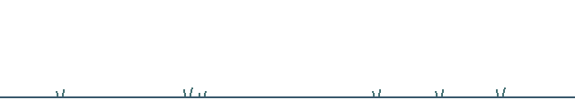

<h1>Hi, I'm Tuan</h1>

<strong>AI systems · Applied ML · Agent tooling</strong>

<picture>
  <source media="(prefers-reduced-motion: reduce)" srcset="assets/soft-signal-pets-still.png">
  
</picture>

I build AI tools, taking ideas from research and experiments into working software.

## Interests

I'm driven by the opportunity to expand what AI can accomplish beyond its native capabilities through systems that maintain context, accumulate knowledge, and enable more effective problem-solving over time. My focus is turning promising ideas and concepts into functional tools, practical applications, and measurable results.

## How I work

I lke starting with a big idea, breaking it down, and learning through experimentation. I pay attention to what fails, question assumptions, and change direction when the evidence points somewhere better.  

## Model experiments

- [Embedding model](https://huggingface.co/Daecore/embeddinggemma-300m-memory-ft-v2) — fine-tuned to retrieve relevant context.
- [Reranker](https://huggingface.co/Daecore/ettin-150m-memory-reranker-ft-v1) — orders passages after a search.
- [Classifier](https://huggingface.co/Daecore/gliclass-knowledge-classifier-v2) — tags passages with labels such as decisions and procedures.

  
  
  
  
  
  
  

Open to opportunities.

<a href="https://www.linkedin.com/in/tnh0527/">LinkedIn</a> · <a href="mailto:tuanhoang571839@gmail.com">Email</a>

